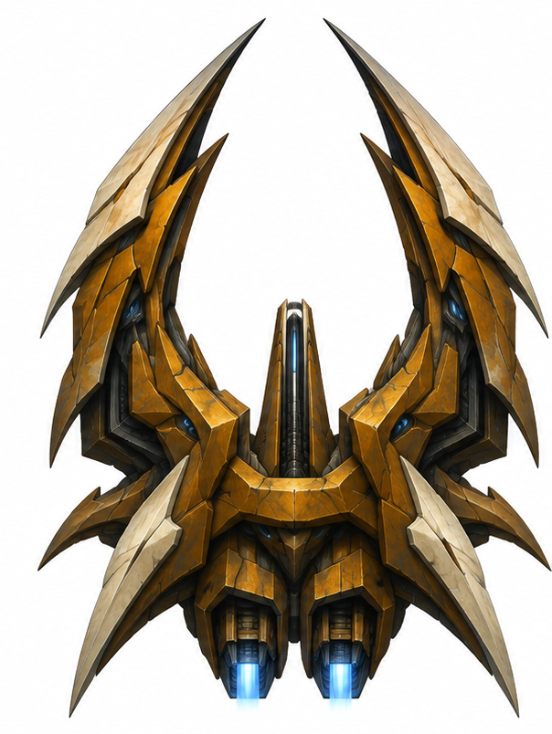
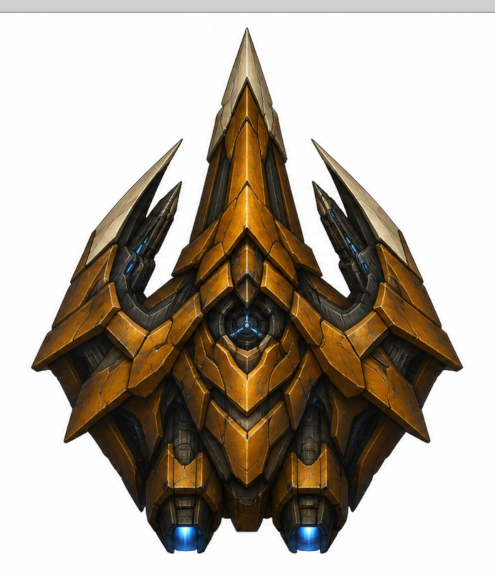
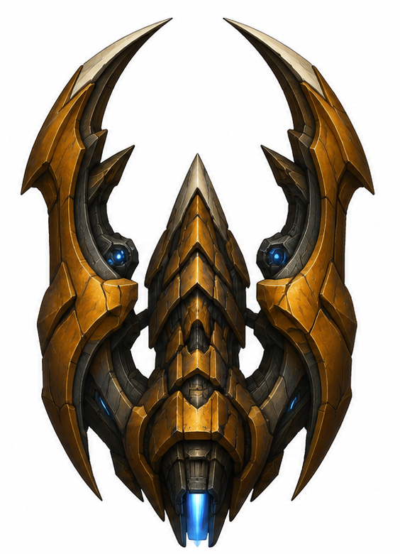
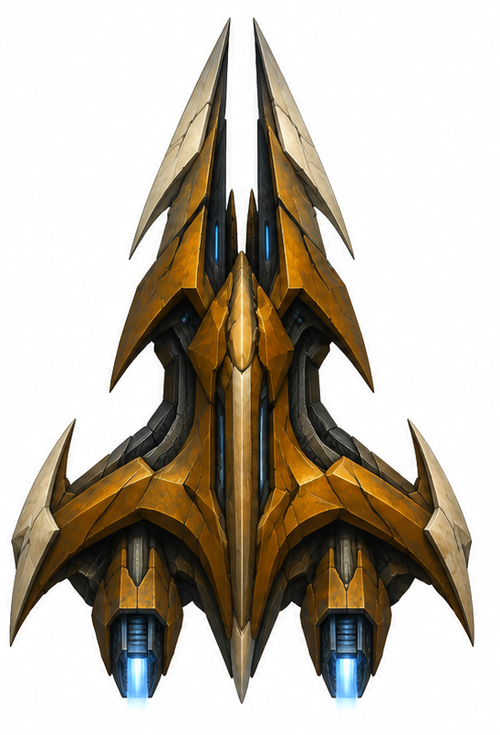
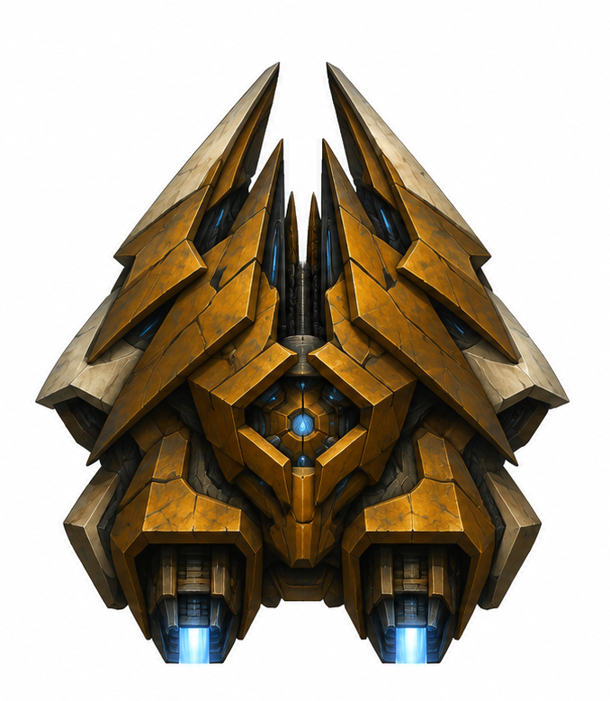
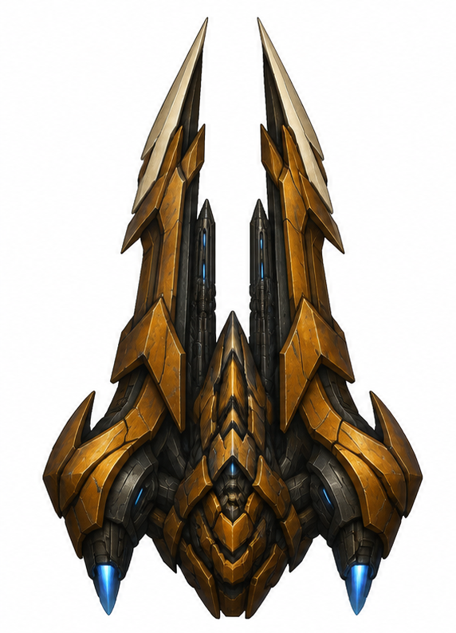

# Eltan — Дети Эльтан

Рабочий репозиторий проекта во вселенной «Космических рейнджеров». Начальный набор: прямые визуальные референсы кораблей и утверждённые назначения.

## Корабли

Эти шесть изображений выбраны автором как **прямые референсы** дальнейшей разработки. Назначения закреплены явно; хищный облик сам по себе не означает военное назначение.

| № | Назначение | Прямой референс |
|---|---|---|
| 1 | Военный истребитель — узкий вариант | [PNG](assets/ships/references/01-fighter-narrow.png) |
| 2 | Пассажирский лайнер | [PNG](assets/ships/references/02-passenger-liner.png) |
| 3 | Пиратский корабль | [PNG](assets/ships/references/03-pirate.png) |
| 4 | Дипломатический корабль / курьер | [PNG](assets/ships/references/04-diplomat-courier.png) |
| 5 | Грузовой транспорт | [PNG](assets/ships/references/05-cargo-transport.png) |
| 6 | Военный истребитель — широкий вариант | [PNG](assets/ships/references/06-fighter-wide.png) |

## Галерея

### 1. Военный истребитель — узкий вариант

### 2. Пассажирский лайнер

### 3. Пиратский корабль

### 4. Дипломатический корабль / курьер

### 5. Грузовой транспорт

### 6. Военный истребитель — широкий вариант

## Материалы

- [Правила работы с дизайнами](docs/ship-design.md).
- [Машиночитаемый список референсов](docs/ship-references.json).
- [Исходные гаальские корабли — вид сверху](assets/ships/source-gaal/topdown/).
- [Первоначальные гаальские референсы в ракурсе](assets/ships/source-gaal/oblique/).

Изображения сохранены без перерисовки, изменения размеров и удаления фона. Это референсы, а не готовые игровые спрайты. Ранние непринятые концепты в набор не включены.

## Происхождение

Исходные гаальские изображения предоставлены пользователем как материалы «Космических рейнджеров»; права на оригинальные материалы принадлежат их правообладателям. Выбранные новые изображения созданы в ходе разработки проекта и затем предоставлены пользователем отдельными файлами. Открытая лицензия на сторонние материалы этим репозиторием не устанавливается.
